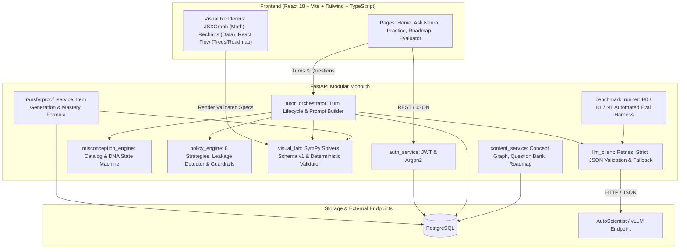
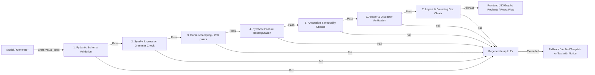

# Architecture & System Design — NEUROTEACH AI

## 1. System Overview
NEUROTEACH AI is architected as a **Modular Monolith** comprising:
1. **Frontend**: React 18, Vite, TypeScript, Tailwind CSS, TanStack Query, React Router.
2. **Backend**: Python 3.11+, FastAPI, Pydantic v2, SQLAlchemy 2.0 (async), Alembic, SymPy.
3. **Database**: PostgreSQL (relational schema for users, sessions, attempts, misconception catalog, mastery profiles).
4. **Pedagogical AI Engine**: Fine-tuned 7B–8B model via Adaption AutoScientist with hosted inference, wrapped in a strict validation & fallback pipeline.

---

## 2. High-Level Architecture Diagram

---

## 3. Core Modules & Responsibilities

| Module | Location | Primary Responsibility |
|---|---|---|
| **Auth** | `backend/app/modules/auth` | User registration, Argon2 hashing, short-lived JWT access tokens and secure HTTP-only cookies. |
| **Tutor Orchestrator** | `backend/app/modules/tutor` | Coordinates dialogue turns, pulls learner history, constructs prompts, invokes LLM client, and triggers guardrails. |
| **Misconception DNA** | `backend/app/modules/misconceptions` | Evaluates error types (`careless`, `conceptual`, `unclear`), transitions learner status (`active` $\rightarrow$ `improving` $\rightarrow$ `resolved`), maps prerequisite links. |
| **Teaching Policy Engine** | `backend/app/modules/policy` | Enforces the 8 teaching strategies, tracks strategy success stats, shifts strategies on repeat failure, enforces answer leakage checks. |
| **TransferProof** | `backend/app/modules/transfer` | Schedules multi-context transfer items (Near, Medium, Far), computes Bayesian smoothed mastery ($M = \frac{\alpha_0 + \sum w_i c_i}{\alpha_0 + \beta_0 + \sum w_i}$). |
| **Visual Pattern Lab** | `backend/app/modules/visual` | Houses 12+ pattern solvers, deterministic validation pipeline (SymPy checks, domain sampling, root recomputation), duplicate prevention. |
| **Content & Roadmap** | `backend/app/modules/content` | Pre-seeded concept graph ($\ge 25$ concepts), question bank ($\ge 60$ questions), prerequisite tracking. |
| **LLM Client & Inference** | `backend/app/modules/llm` | Resilient HTTP client, JSON schema enforcement, JSON-repair, automatic retry, and fallback to static hints on validation failure. |
| **Benchmark Runner** | `backend/app/modules/eval` | Head-to-head comparison harness executing B0, B1, and NT against held-out benchmark datasets. |

---

## 4. Visual Pattern Lab & Deterministic Validation Pipeline

The model is strictly prohibited from returning unstructured plots or direct image bitmaps. It only generates typed `visual_spec` JSON adhering to Schema v1.

---

## 5. Security, Data Validation & Privacy
1. **No Client Eval**: All mathematical expressions are parsed using an isolated AST whitelist in SymPy. No `eval()` or dynamic execution on the backend or frontend.
2. **Zero Direct Student Text in Model Logs**: Request hashes, latency, and token metrics are logged to `model_calls` without persisting sensitive user PII.
3. **Guardrails over Model**: Model proposals are treated as unverified recommendations. Policy switches, mastery scores, and answers are deterministically verified in Python.
