# Implementation Plan — NEUROTEACH AI

## 1. Roadmap Overview & Milestones

The implementation is structured into 6 sequential phases designed to fit a rapid MVP build while maintaining safety and verification standards.

```mermaid
gantt
    title NEUROTEACH AI Implementation Phases
    dateFormat  X
    axisFormat %s
    section Phase 1: Core Foundation & Dataset
    Scaffolding & DB Models           :active, p1_1, 0, 15
    Catalog & Synthetic Dataset Prep  :p1_2, 15, 30
    section Phase 2: Engine & Validation
    VPL Solvers & Validation Pipeline :p2_1, 30, 50
    Misconception DNA & Policy State  :p2_2, 50, 70
    TransferProof & Bayesian Mastery  :p2_3, 70, 85
    section Phase 3: AutoScientist & Eval
    AutoScientist Training / Mock     :p3_1, 85, 105
    Head-to-head Benchmark Harness    :p3_2, 105, 120
    section Phase 4: Backend API & Auth
    FastAPI Orchestrator & Endpoints  :p4_1, 120, 140
    section Phase 5: Frontend Experience
    Design System & App Shell         :p5_1, 140, 160
    5 Core MVP Screens & JSXGraph     :p5_2, 160, 185
    section Phase 6: E2E Testing & Polish
    Full Flow Verification & Judge UI :p6_1, 185, 200
```

---

## 2. Detailed Phase Breakdown

### Phase 1: Core Foundation, Catalogs & Synthetic Dataset
- **Objective**: Establish the relational schema, pre-seed content, and author the authoritative misconception catalog and synthetic training data.
- **Tasks**:
  1. Set up SQLAlchemy async database models (`users`, `sessions`, `attempts`, `misconceptions`, `concepts`, `questions`, `mastery_profiles`, `model_calls`).
  2. Author the Misconception Catalog (~60 entries across Python, DSA, AI/ML, Mathematics).
  3. Author the Pattern Library config (~12 patterns with deterministic SymPy solvers).
  4. Build the dataset generation script (`ml/scripts/generate_synthetic_dataset.py`) to produce 3,000–6,000 verified multi-turn examples with frozen stratified splits (Train, Val, Held-Out Test).
- **Deliverables**: Seeded DB migrations, verified dataset JSONL files, frozen test suite.

### Phase 2: Pedagogical Engine & Deterministic Guardrails
- **Objective**: Implement the four signature algorithmic features in Python.
- **Tasks**:
  1. **Visual Pattern Lab**: Implement `visual_spec` Schema v1 and the 7-step deterministic validation pipeline (SymPy AST check, 200-point sampling, feature recomputation, distractor validation).
  2. **Misconception DNA Engine**: Build error classifier (`careless` vs `conceptual` vs `unclear`) and the learner state machine (`active` $\rightarrow$ `improving` $\rightarrow$ `resolved`).
  3. **Adaptive Teaching Policy Engine**: Implement the 8 strategies, dynamic switching rules (switch after 2 failures), hint ladder, and answer leakage guardrail.
  4. **TransferProof & Mastery**: Implement the Bayesian smoothed mastery formula ($M$) and multi-context transfer item scheduler (Near, Medium, Far).
- **Deliverables**: Pytest test suite covering all validators, state transitions, and math edge cases.

### Phase 3: Model Training via Adaption AutoScientist & Benchmark Harness
- **Objective**: Fine-tune the pedagogical model or configure the hosted AutoScientist LoRA adapter, and benchmark against B0 and B1.
- **Tasks**:
  1. Upload validated dataset to Adaption AutoScientist platform (or configure local LoRA / mock fallback for development).
  2. Implement `llm_client` supporting structured JSON generation, automatic repair, and static hint fallback.
  3. Build the automated benchmark harness (`make benchmark` / `ml/evaluations/run_benchmark.py`) testing B0 (base), B1 (static tutor), and NT (NEUROTEACH) across the held-out test set.
- **Deliverables**: Benchmark report output with 95% bootstrap confidence intervals and ten annotated transcripts.

### Phase 4: Backend API & Orchestration
- **Objective**: Complete the FastAPI modular monolith endpoints.
- **Tasks**:
  1. Auth endpoints (`/api/auth/register`, `/api/auth/login`, `/api/auth/me`).
  2. Tutor Orchestrator (`/api/tutor/turn`, `/api/tutor/session`).
  3. Visual Lab endpoints (`/api/visual/validate`, `/api/visual/similar-question`, `/api/visual/change-pattern`).
  4. Roadmap & Evaluator endpoints (`/api/roadmap`, `/api/evaluator/mastery`).
- **Deliverables**: Fully documented Swagger/OpenAPI docs and passing integration tests.

### Phase 5: Modern Frontend Web Application
- **Objective**: Deliver a dark-first, state-of-the-art UI for the 5 MVP modules.
- **Tasks**:
  1. Build design system (`index.css` with dark tokens, Inter font, JetBrains Mono, glassmorphism cards, accessible contrast).
  2. Implement persistent app shell (sidebar with active indicators and "Soon" badges for Phase 2 modules).
  3. Implement **Home Dashboard** (Goal ring, streak, top weak concepts, recommended activities).
  4. Implement **Ask Neuro** (Chat stream, diagnosis cards, hint ladders, insight sidebar).
  5. Implement **Practice View** with embedded **Visual Pattern Lab** (JSXGraph interactive plots, parameter sliders $< 200\text{ms}$, reasoning input).
  6. Implement **Roadmap View** (React Flow concept DAG, prerequisites, locked/mastered states).
  7. Implement **Evaluator View** (Mastery breakdown modal, misconception progression, judge benchmark view).
- **Deliverables**: Responsive, interactive frontend running on Vite dev server.

### Phase 6: End-to-End Verification & Demo Polish
- **Objective**: Execute end-to-end user journeys, benchmark validations, and polish micro-interactions.
- **Tasks**:
  1. Verify zero answer leakage across scripted test sessions.
  2. Verify 100% of rendered graphs pass deterministic validation.
  3. Validate interactive parameter slider responsiveness and duplicate prevention.
  4. Finalize judge evaluation view for competition presentation.
